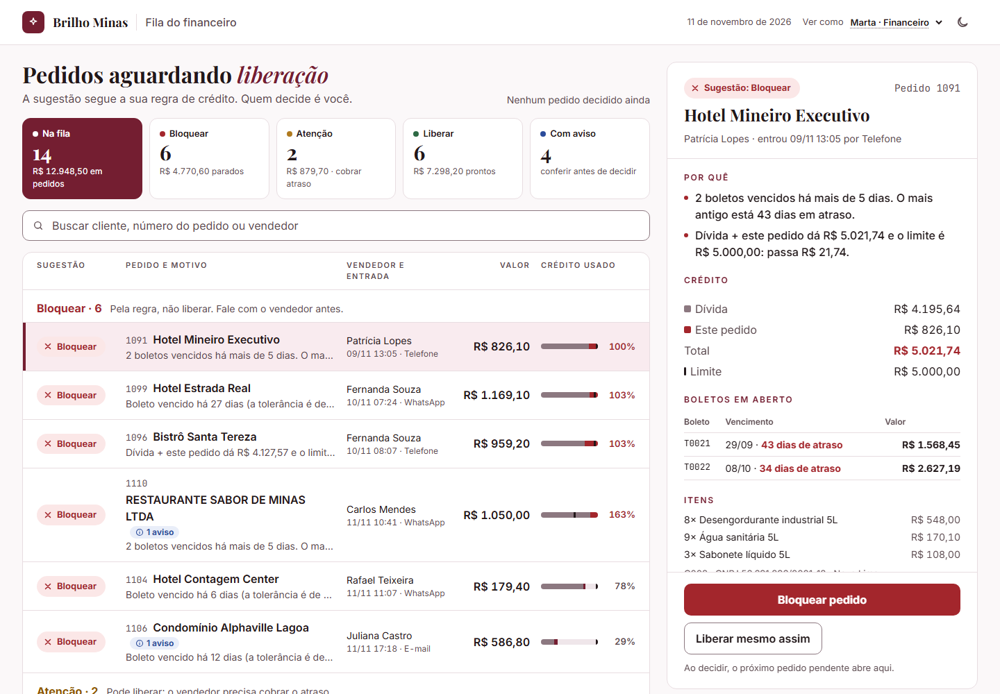

# Brilho Minas · Fila do financeiro

A fila de liberação de pedidos da Brilho Minas, com a regra de crédito da Marta aplicada aos dados do Sistemão:
- **Financeiro:** vê a fila com a sugestão (Liberar, Atenção ou Bloquear) e o motivo de cada pedido.
- **Vendedor:** vê no celular só os próprios pedidos e clientes, sem valores de dívida.

**Abrir:** https://mais4g.github.io/brilho-minas-fila-financeiro/

| Parte | Onde está |
|---|---|
| 1 · Diagnóstico | [`DIAGNOSTICO.md`](DIAGNOSTICO.md) |
| 2 · Tela | [link acima](https://mais4g.github.io/brilho-minas-fila-financeiro/) ou [`tela/index.html`](tela/index.html) |
| Conversa com a IA (sem edição) | [`docs/conversa-com-ia.md`](docs/conversa-com-ia.md) |
| Plano e acompanhamento | [`docs/plano.md`](docs/plano.md) |

| Marta (financeiro) | Vendedora no celular |
|---|---|
|  |  |

## Como abrir

- **Pelo link acima**, ou
- **Sem internet:** abra `tela/index.html` deste repositório com dois cliques. Cada página é um arquivo único, com tudo dentro; não precisa instalar nada.

**Para usar a tela:**
- Escolha quem está olhando. No canto superior direito, **"Ver como"** troca de perfil, e o ícone de **lua/sol** troca o tema.
- Marta: clique num pedido para ver o detalhe ao lado. Os cartões do topo filtram a fila.
- Vendedor: a aba **"Meus clientes"** mostra quem está liberado antes de prometer entrega.

## Decisões principais

- **A regra:**
  - **Bloquear:** boleto vencido há **mais de 5 dias**, ou dívida + pedido **passando** do limite.
  - **Atenção:** 1 a 5 dias de atraso.
  - **Liberar:** nenhum dos casos acima.
  - **Casos-limite:** 5 dias dá Atenção e 6 dá Bloquear; exatamente no limite libera; o vencimento vale mais que o status do boleto. Cada caso tem teste.
- **Um arquivo por perfil.** O arquivo do vendedor só contém os dados dele, e isso é verificado por teste. Sem login, qualquer arquivo abre; no sistema real, o servidor entregaria só o perfil de quem entrou.
- **Para o vendedor, é previsão.** Enquanto a Marta não decide, ele vê "Deve ser liberado", e não "Liberado", para não prometer em cima de uma sugestão.
- **A decisão da Marta fica só na tela** e a tela avisa isso. Gravar no Sistemão é o próximo passo.
- **O vendedor só consulta, não preenche nada.** O enunciado pede a visão dele, não o lançamento de pedidos; lançar o pedido uma vez só é a semana 2 da proposta.
- **Os dados estão no repositório porque são fictícios** e vieram com o desafio, então os números batem com os arquivos originais. Com dados reais, não estariam aqui: a explicação completa está em [detalhes](docs/detalhes.md#dados-por-que-estão-no-repositório).
- **Visual com a identidade do Divos da IA**, tema claro e escuro, e acessibilidade (WCAG 2.2 AA como referência, com contraste testado nos dois temas): [`docs/acessibilidade.md`](docs/acessibilidade.md).
- **Stack:** TypeScript, React, Zod (valida cada registro do Sistemão) e Vitest (161 testes), empacotados num HTML por perfil. O CI testa e publica a cada push.

## O que encontrei de estranho nos dados

| O que | O que fiz |
|---|---|
| **Mesmo restaurante cadastrado 2 vezes** (C001 e C037: mesmo CNPJ e telefone, nome digitado diferente, limites diferentes). O pedido 1110 caiu no cadastro "limpo" e esconderia 72 dias de atraso | Juntei os dois: **1110 vira Bloquear**, com aviso. Uso o menor limite até confirmar qual vale |
| **Boleto T0132 "aberto", mas vencido há 12 dias** | Vale a data: **1106 vira Bloquear**, com aviso |
| **Pedidos 1105 e 1108 iguais**, no mesmo minuto ("digitado 2x?") | Aviso de pedido em dobro para a Marta e para a vendedora; juntos, passariam do limite |
| **C038 "Hotel Savasi Plaza"**: sem CNPJ, sem vendedor, limite 0, e nome quase igual ao C018 "Hotel Savassi Plaza" | Aparece no relatório como provável cadastro repetido; não junto sem CNPJ para confirmar |
| **Pedido 1013**: 120 unidades ("cliente pediu 12") e comissão errada; **pedido 1006** sem vendedor | Já entregues: só registrados |
| **Ninguém registra quem liberou** (`liberado_por` vazio nos 110 pedidos) | Registrado; reforça o diagnóstico |

A lista completa é gerada a cada build em [`docs/anomalias-dos-dados.md`](docs/anomalias-dos-dados.md).

## O que ficou de fora

- Gravar a decisão da Marta e avisar o vendedor.
- Visão da diretoria (Renata).
- Teste com leitor de tela real, e com a Marta e um vendedor de verdade.

## Como usei a IA

Usei o Claude Code do começo ao fim. A conversa exportada, sem edição, está em [`docs/conversa-com-ia.md`](docs/conversa-com-ia.md).

**Tempo:** cerca de 3 horas, em 12/11. Pedi à IA para não se prender ao tempo (linha 285 da conversa) e investi a sobra em validação dos dados, testes da regra e acessibilidade.

**Momentos-chave da conversa** (número da linha):
- **225:** questionei a primeira proposta (HTML + JS puro) e pedi mais robustez.
- **785:** pedi as alternativas antes de aceitar as duas decisões sobre os dados.
- **870:** mostrei que C001 e C037 são a mesma empresa, que a IA tratava como suposição.
- **1036 e 1385:** proteção de dados: primeiro esconder os sensíveis, depois a decisão de usar os fictícios e documentar por que não faria isso com dados reais.
- **4449 e 4473:** revisei a tela e pedi uma conferência completa contra o enunciado.

**Onde ajudou:**
- achou as sujeiras dos dados antes de qualquer tela;
- escreveu a regra com os testes de casos-limite;
- fez as telas, o protótipo visual, os temas, a acessibilidade e o deploy.

**Onde precisei corrigir:**
- A primeira proposta foi HTML + JavaScript puro, e pedi mais robustez.
- Ela tratou C001/C037 como suposição; eram a mesma empresa com o nome digitado diferente.
- A visão do vendedor ficou com largura de celular até no computador.
- A revisão de código mostrou que o mascaramento dos dados não protegia de verdade.

**Ela mesma corrigiu:**
- um teste de segurança errado;
- a comissão que vazaria para a Marta;
- a borda da busca sem contraste.

A lista completa está em [detalhes](docs/detalhes.md#como-usei-a-ia).

## Para quem for mexer no código

```bash
npm ci && npm run check   # tipos + 161 testes + build (o mesmo que o CI)
npm run dev               # servidor local (PERFIL=V01 npm run dev para um vendedor)
```

```
DIAGNOSTICO.md   Parte 1
tela/            Parte 2 pronta: um HTML por perfil (é o que vai para o Pages)
src/             regra de crédito (src/dominio) e telas (src/app)
testes/          regra, segurança por perfil, dados, contraste
scripts/         geração dos dados por perfil e build
dados/           JSONs do Sistemão e o LEIA-ME original
docs/            detalhes, plano, conversa com a IA, acessibilidade, anomalias e prints
```

A estrutura do código e todas as decisões, uma a uma, estão em [`docs/detalhes.md`](docs/detalhes.md).
