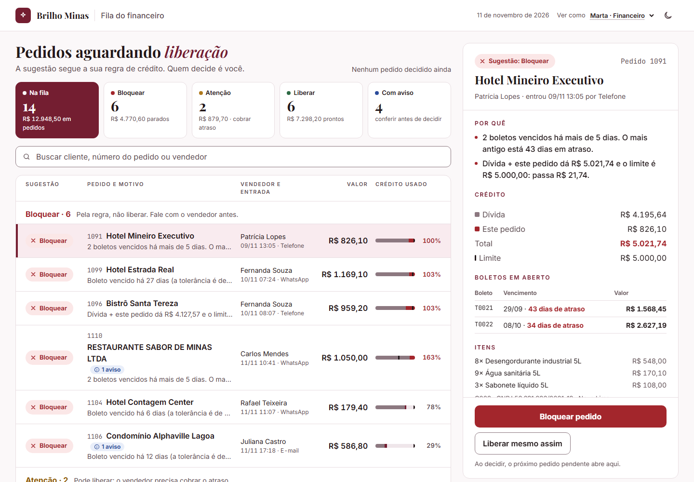
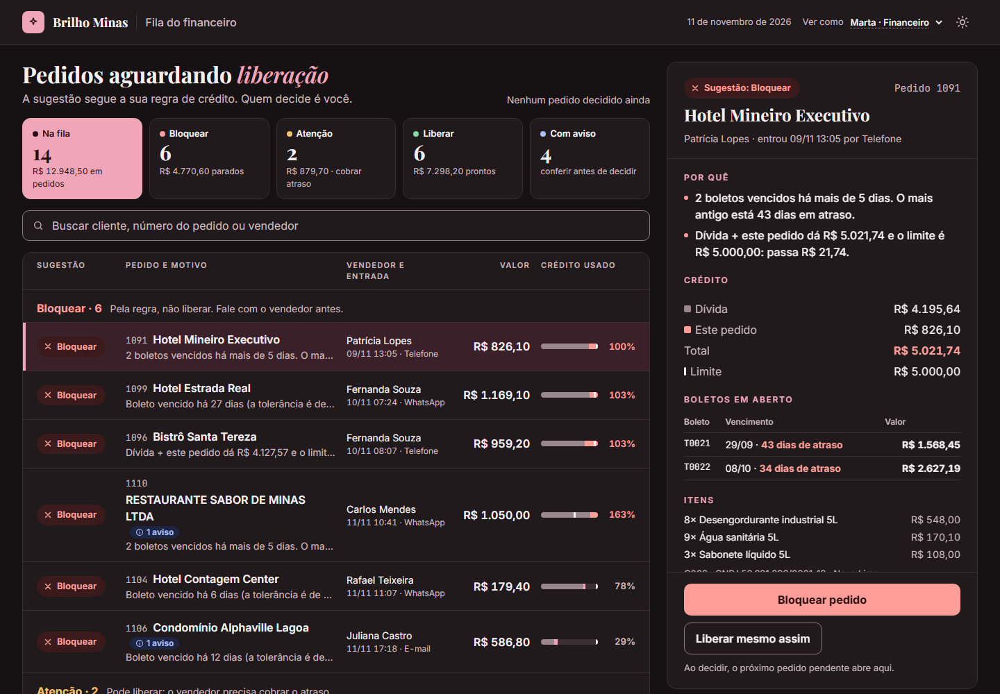
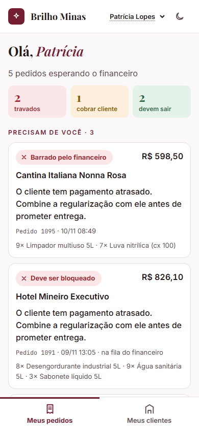
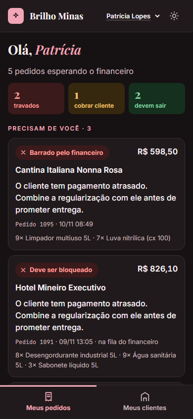

# Acessibilidade e temas

A Marta passa o dia nessa tela, e os vendedores a usam no celular, na rua, no sol, às vezes com uma mão só. Por isso a referência foi o **WCAG 2.2, nível AA**: o mínimo que se pede de um sistema usado por qualquer pessoa, inclusive quem usa leitor de tela, só teclado, zoom alto ou modo de alto contraste.

O que está garantido **por teste automatizado** é dito como tal. O resto foi conferido manualmente e está marcado na seção [O que foi conferido e como](#o-que-foi-conferido-e-como).

## Temas: claro e escuro

| | Claro | Escuro |
|---|---|---|
| Marta |  |  |
| Vendedora |  |  |

- **Segue o sistema por padrão** (`prefers-color-scheme`). O **botão de lua/sol** no canto superior direito troca entre claro e escuro, e a escolha fica salva no navegador.
- **O botão diz o que faz, não o estado:** o nome acessível é "Usar tema escuro" ou "Usar tema claro", que é o padrão para botões de alternar. É só um ícone, mas tem nome para o leitor de tela e dica ao passar o mouse.
- **Sem flash do tema errado:** o tema é aplicado antes de a tela ser desenhada.
- **Se o navegador não deixar salvar** (aba anônima, arquivo aberto do disco), a tela funciona igual, só não lembra a escolha.
- **Identidade visual:** a do Divos da IA. Bordô como cor principal, fundo levemente rosado, Playfair Display nos títulos, Inter no texto e JetBrains Mono em números de pedido e boleto. O escuro é derivado dela: as mesmas cores, clareadas até passarem no contraste.
- **As cores ficam num lugar só:** [`src/app/tema.ts`](../src/app/tema.ts). O CSS só usa as variáveis geradas a partir dele, então um teste consegue conferir todas.

## Contraste (testado)

[`testes/contraste.test.ts`](../testes/contraste.test.ts) calcula o contraste pela fórmula do WCAG para cada combinação de cor que aparece na tela, **nos dois temas**:

- **Texto: 4,5:1 ou mais** (critério 1.4.3). São 29 pares por tema: texto normal e suave sobre cada fundo, cada cor de status sobre o próprio fundo, botões, a linha selecionada e a linha sob o cursor.
- **Elementos gráficos e bordas de controles: 3:1 ou mais** (critério 1.4.11). São 11 pares por tema: borda do campo de busca e dos seletores, contorno de foco, partes da barra de crédito e marcadores de status.

Hoje, o par mais apertado é a parte da barra que representa a dívida, com 3,36:1 no claro e 3,81:1 no escuro. Quem mudar uma cor e quebrar o contraste vê o teste falhar no CI.

**Um caso que o teste pegou no desenho:** no protótipo, a borda do campo de busca usava a cor das linhas divisórias, com cerca de 1,5:1. Para quem enxerga pouco, o campo "some" da tela. A borda passou a ter uma cor própria (`controle`), com 4,1:1.

## A cor nunca é a única pista (1.4.1)

- **Cada status tem cor, forma e palavra.** Bloquear tem ✕, Atenção tem !, Liberar tem ✓, e o texto vem sempre ao lado. Dá para entender em escala de cinza ou com daltonismo.
- **Cada cor tem um papel só.** Vermelho, âmbar e verde são da decisão de crédito. **Avisos de dados** (cliente cadastrado em dobro, pedido repetido) usam **azul-cobalto** e um ícone próprio. No protótipo, aviso e "Atenção" eram âmbar, e isso confundia.
- **Barra de crédito:** a cor mostra a proporção, mas os números estão sempre escritos ao lado (percentual na linha; dívida, pedido, total e limite no detalhe).

## Teclado e foco

- **Tudo funciona só com o teclado.** Linhas da fila, filtros, abas do celular e botões são `<button>` de verdade, e nenhum `div` se finge de botão. A ordem de tabulação segue a ordem visual.
- **As abas do vendedor vêm antes do conteúdo no código.** No computador elas aparecem no topo; no celular ficam presas embaixo, ao alcance do polegar. Assim, quem usa teclado ou leitor de tela chega a elas logo, sem atravessar a página inteira.
- **Foco sempre visível** (2.4.7 e 2.4.11): contorno azul de 3px, com contraste testado nos dois temas. Ele aparece com teclado e não aparece com clique de mouse.
- **"Pular para o conteúdo"** é o primeiro item do Tab (2.4.1): pula o cabeçalho e os seletores.
- **Gerenciamento de foco:** em tela estreita, o detalhe do pedido fica abaixo da lista. Ao escolher um pedido, o foco vai para o título do detalhe, e quem usa teclado ou leitor de tela não precisa caçar onde ele abriu.
- **Depois de decidir**, o próximo pedido pendente abre sozinho. Isso é anunciado (próxima seção), não acontece em silêncio.

## Leitor de tela

- **Estrutura semântica:** um `<h1>` por tela; `<h2>` para os grupos Bloquear, Atenção e Liberar e para o detalhe; `<h3>` para as seções do detalhe. Há regiões nomeadas (`header`, `main`, `nav`, `aside` "Detalhe do pedido"), então dá para navegar por títulos e regiões.
- **Estado dos controles:**
  - os filtros usam `aria-pressed`;
  - a linha aberta usa `aria-current` e aponta para o painel com `aria-controls`;
  - a aba ativa do celular usa `aria-current="page"`.
- **Anúncios** (`aria-live="polite"`), por exemplo:
  - ao filtrar: "6 pedidos na lista.";
  - ao decidir: "Pedido 1091 marcado como bloqueado. Abrindo o pedido 1099.";
  - ao desfazer: "Decisão do pedido 1091 desfeita."
- **Texto extra só para o leitor**, onde o visual é abreviado:
  - o número na linha vira "Pedido 1091";
  - o percentual vira "100% do limite";
  - a busca tem nome ("Buscar na fila") mesmo sem rótulo visível.
- **Tabela de boletos:** é uma `<table>` com legenda e cabeçalhos (`<th scope="col">`).
- **Ícones** são decorativos (`aria-hidden`), porque o significado está no texto ao lado.
- **Idioma:** `lang="pt-BR"`, para o leitor pronunciar em português. Cada página tem título próprio ("Fila do financeiro · Brilho Minas", "Pedidos de Patrícia Lopes · Brilho Minas").

## Zoom, tamanho de texto e telas pequenas

- **Tamanhos em `rem`:** se a pessoa aumenta a fonte padrão do navegador, a tela inteira acompanha (1.4.4).
- **Sem rolagem lateral em 320px de largura** (1.4.10):
  - a fila deixa de ser uma grade e empilha em cada linha, por *container query* (depende do espaço da lista, não da janela);
  - o detalhe passa para baixo da lista;
  - no celular, o rótulo "Ver como" sai da vista, mas continua no controle para o leitor de tela;
  - a visão do vendedor também se adapta para cima: no computador, os cartões ficam em colunas e as abas vão para o topo.
- **Alvos de toque com pelo menos 44px** (acima do 2.5.8, que pede 24px): botões, filtros, seletores, busca e as abas de baixo, que têm 68px de altura e ficam no alcance do polegar.
- **Nomes longos quebram em até 2 linhas**, em vez de virar "RE...". No protótipo, "RESTAURANTE SABOR DE MINAS LTDA" aparecia cortado.

## Preferências do sistema

- **Menos movimento** (`prefers-reduced-motion`): animações e rolagem suave desligadas. A tela já quase não tem animação; a regra garante que nada novo escape.
- **Alto contraste do Windows** (`forced-colors`): o sistema troca as cores. Selos, cartões e barras ganham contorno, e a linha selecionada, o filtro ativo e a aba ativa ganham destaque na cor de seleção do sistema, para nada sumir.
- **Fontes embutidas no HTML:** a tela abre igual sem internet e não faz requisição a terceiros (ninguém de fora fica sabendo quem abriu).

## O que foi conferido e como

| Item | Como |
|---|---|
| Contraste dos dois temas | **Teste automatizado** (`testes/contraste.test.ts`), roda no CI |
| Dados por perfil (o vendedor não recebe dívida) | **Teste automatizado** (`testes/seguranca.test.ts`) |
| Visual nos dois temas, em 1440px e em 390px | Prints gerados com o Chrome em modo headless (`docs/prints/`) |
| Navegação por teclado, foco e anúncios | Revisão do código (elementos nativos, atributos ARIA). **Ainda não** foi testado com leitor de tela real |

## O que ainda falta

- **Testar com leitor de tela de verdade:** NVDA no Windows e TalkBack no Android, que é o celular mais provável dos vendedores. Também um teste automático com axe-core (por exemplo, Playwright + `@axe-core/playwright`) no CI.
- **Testar com quem usa:** 15 minutos com a Marta e com um vendedor, no celular dele, na rua. Nenhuma checklist substitui isso.
- **Atalhos de teclado para a Marta**, como J/K para próximo e anterior e L/B para liberar e bloquear. Só depois de saber se ela usa mais teclado ou mouse.
